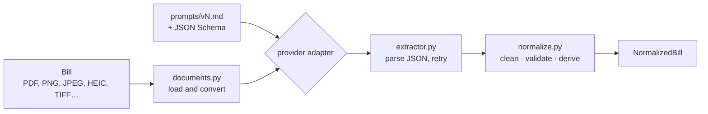
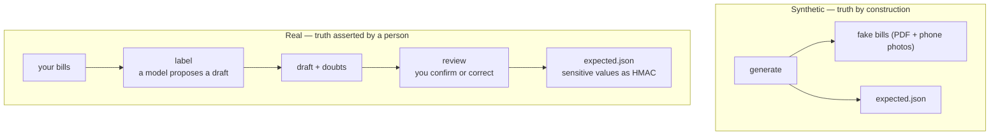

# How BillMeter works

Three loops around one output contract (`schema.py`):

| Flow | Command | Question it answers |
|---|---|---|
| Extraction | `extract` | What does this bill say? |
| Ground truth | `generate`, `label`, `review` | What is the *right* answer for these bills? |
| Evaluation | `eval`, `compare`, `report` | Did my change help, and where? |

The middle one is the expensive one, and the one most projects skip. It is also what makes the
third one mean anything.

## 1. One bill → structured data

**Load** (`documents.py`). PDFs go as they are to providers that read them natively; otherwise every
page is rendered to a PNG (8 pages max). HEIC, TIFF, BMP and GIF become PNG, rotated upright by EXIF
and scaled down. A file that cannot be decoded raises `UnreadableDocument` and is skipped by name —
one corrupt file never kills a run that has already paid for other calls.

**Prompt** (`prompts/`). Plain text, one file per version. The JSON Schema replaces `{{SCHEMA}}`, and
every run records a hash of the exact text sent.

**Call** (`providers/`). One small adapter per provider, each using that provider's own
structured-output feature. The rest of the code never knows which model is behind it.

**Parse** (`extractor.py`). JSON is read, also from inside code fences. Network errors, rate limits
and invalid JSON are retried twice; configuration errors stop immediately.

**Normalize** (`normalize.py`). This is where the guarantees live: Italian numbers (`2.700` → 2700,
`3,5` → 3.5) and dates, POD and PDR patterns, the *codice fiscale* check character, plausible power
and periods. The bill type is decided by the codes found, not by what the model declared. Fields
that don't belong to that type are dropped. The yearly estimates are computed here, never asked of
the model.

**A value that fails validation becomes empty**, because an empty field in an auto-filled form is
better than a wrong one. What was discarded is kept in `result.dropped`, so you can tell "the model
never read it" from "the model read it and we threw it away".

## 2. Where the right answers come from

**Synthetic.** `synthetic.py` invents the data first and *then* prints the bill, so the right answer
is known exactly and no labeling error is possible. Each bill carries the traps real ones have: a
mailing address next to the supply address, F1/F2/F3 bands next to the total, kWh figures inside tax
tables, gas in Smc beside electricity on dual bills, business holders with a VAT number. Same seed,
same files byte for byte. Its limit is structural: **it only contains the traps someone thought of.**

**Real.** A model proposes, a person decides. To keep the review honest, every draft carries
**doubts** — the fields that deserve a careful look, each with the reason why. The rules are
deterministic, no model decides what to distrust: a value validation discarded, a failed extraction,
an undecided bill type, a field the bill type should carry but is empty, and with
`label --second-model` every field two models disagree on, judged by the same comparators the
graders use. `review` shows the most doubtful drafts first.

> **A golden dataset is only "golden" if it was verified independently of the system it has to
> measure.** Confirming a model's proposals without rereading the document copies that model's
> errors straight into the ground truth, and the eval then reports agreement and calls it accuracy.
> The doubts and the second model exist to make that loop expensive to fall into.

## 3. Turning answers into numbers

Every field present in `expected` gets exactly one outcome:

| Outcome | Meaning |
|---|---|
| `correct` | expected X, got X |
| `correct_null` | nothing expected, nothing returned |
| `missing` | expected X, got nothing |
| `wrong` | expected X, got Y |
| `hallucinated` | nothing expected, got something |

`wrong` + `hallucinated` = **dangerous rate**. In a pre-filled form a wrong tax code is invisible to
the user while an empty field is not, so the two failures get two numbers, not one average.

Three accuracies are reported, because one number cannot carry this:

| Metric | Asks | Counts |
|---|---|---|
| `field_accuracy` | overall | `correct` + `correct_null`, over everything |
| `filled_accuracy` | right where the bill **has** a value? | `correct` / (`correct` + `missing` + `wrong`) |
| `empty_accuracy` | quiet where it has **nothing**? | `correct_null` / (`correct_null` + `hallucinated`) |

`field_accuracy` has a floor: about a third of this dataset is expected-null, so a model answering
null to everything already scores 30 %. The other two have none, and they fail in opposite
directions — a model can read a bill perfectly and still be useless by inventing a value for every
field the document does not carry. Measuring only one of them hides exactly half the ways to be
wrong; see [RESULTS.md](RESULTS.md#read-the-two-middle-rows-again), where that is what happened.

**Field-aware comparison.** Exact for codes, dates and the bill type; relative tolerance for numbers;
same words in any order for names (`ROSSI MARIO` = `Mario Rossi`); similarity for the supplier; and
for addresses an exact postcode and street number plus similarity on the rest. See `COMPARATORS` in
`evals/graders.py`.

**What is not graded.** The two yearly estimates are computed by `normalize.py` from fields that are
already graded, so grading them would count the same mistake twice and say nothing about the model.
Their arithmetic is covered by unit tests instead.

**Also per run:** fully correct documents, error rate, latency p50/p95, tokens, cost from your own
`pricing.json`, and — with `--runs N` — **stability**, the share of (document, field) pairs whose
outcome never changed between runs. Temperature 0 does not guarantee identical answers, so this is
measured rather than assumed.

**Traces.** On datasets with no real data, each record also keeps the model's raw answer and the raw
value of every field *before* normalization, so a failure reads as expected / raw / normalized:

| What you see | Who got it wrong |
|---|---|
| `raw` already wrong | the model misread the bill → prompt or model |
| `raw` right, `normalized` empty | validation threw a good value away → `normalize.py` |
| `raw` empty | the model never found it → page limit, resolution, prompt |
| `raw` empty here, the same value `raw` somewhere else | the model read it and filed it under the wrong field → prompt |

That last row is not hypothetical: it is the entire failure list of one model in
[RESULTS.md](RESULTS.md), where the aggregate reported 24 missing fields and 24 invented ones and
the raw values showed a single mislabelled field. On data marked as real, none of this is stored:
only the outcomes.

## Running an evaluation

The commands are in the [README](README.md#quickstart). The options worth knowing:

| Option | When |
|---|---|
| `--limit 5` | a quick check before a full run |
| `--tag photo` | only part of the dataset |
| `--runs 3` | measure stability; triples the time |
| `--concurrency N` | defaults to 1 for a local model, 4 otherwise |
| `--temperature none` | models that reject the parameter |
| `--effort low` | models that reason before answering: extraction needs none, and those tokens are billed as output |
| `-d dataset/private` | your own bills |

`compare` warns when the two runs used different versions of the dataset (`dataset_sha256`). If
`expected.json` changed between them, the numbers are not comparable.

## Labeling your own bills

The step-by-step is in [dataset/private/README.md](dataset/private/README.md). One piece of advice
paid for in mistakes: **do not label with the model you intend to measure**, and do not press Enter
through the fields. Both produce a ground truth that agrees with that model by construction.

## Extending it

| You want to | Do this |
|---|---|
| Add a provider | One class in `providers/` implementing `generate()`, registered in `providers/__init__.py` |
| Add a field | Add it to `schema.py`, describe it in the prompts, give it a comparator in `graders.py` if exact match is wrong |
| Add a prompt version | Drop a `prompts/vN.md` in place; the schema is substituted and the hash recorded automatically |
| Add a doubt rule | A rule in `find_doubts()` in `labeling.py`. Keep it deterministic |
| Change how a value is cleaned | `normalize.py`. A stricter rule turns `wrong` into `missing` — usually the right trade, but a trade |

Every one of these is covered by `uv run pytest`, which replaces each provider SDK with a fake that
records the request, so the tests check exactly what would be sent without calling any API.

Back to the [README](README.md) · the numbers: [RESULTS.md](RESULTS.md)
