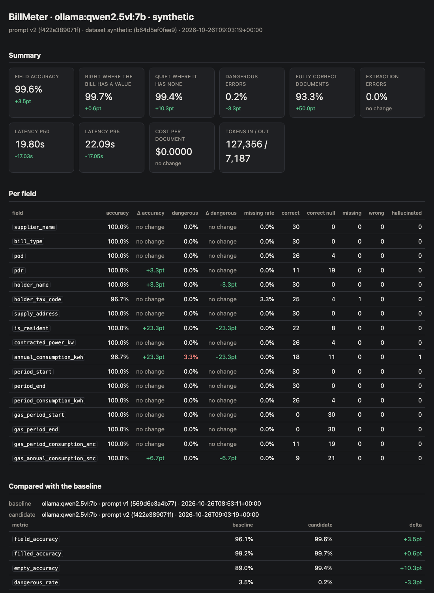
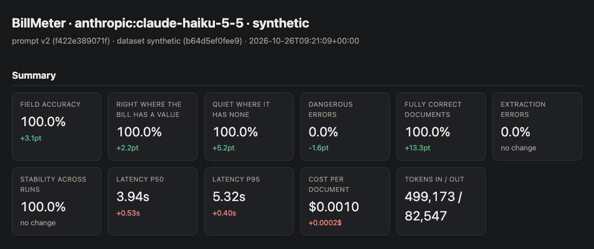

# BillMeter

**Extract structured data from Italian utility bills with any AI model — and measure, field by
field, whether a change made things better or worse.**

Give BillMeter a bill (PDF, scan or phone photo) and it returns what a supplier-switch form needs:
supply point codes, account holder, tax code, supply address, residency, contracted power, billing
periods, electricity (kWh) and gas (Smc) consumption.

That part is easy. The point of this project is the **evaluation harness** around it. Everyone
tweaks a prompt and says it got better. Here, every model and every prompt change is graded on the
same documents, field by field, with the dangerous errors counted separately from the visible ones.

> In an auto-filled form, a **wrong** value is far worse than a **missing** one. A wrong tax code is
> invisible to the user; an empty field is not. So they are counted separately.

## What measuring actually caught

**1. A prompt rewrite, measured instead of assumed.** `prompts/v1.md` is the baseline anyone writes
first: the task, plus the output schema. `prompts/v2.md` adds the domain rules — Italian number
formats, which figure on the page is which, and when to answer `null`. Same models, same 30
documents, same dataset hash; the prompt file is the only thing that moves.

| | local v1 | local v2 | hosted v1 | hosted v2 |
|---|---|---|---|---|
| Right where the bill **has** a value | 99.2 % | 99.7 % | 97.8 % | **100 %** |
| Quiet where it has **nothing** | 89.0 % | **99.4 %** | 94.8 % | **100 %** |
| Dangerous errors (`wrong` + `hallucinated`) | 3.5 % | 0.2 % | 1.6 % | **0 %** |
| Fully correct documents | 43.3 % | 93.3 % | 86.7 % | **100 %** |

Local is `ollama:qwen2.5vl:7b` (510 grades), hosted is `anthropic:claude-haiku-5-5` (1530 grades,
every document run 3×). **0 regressions on either model** — 18 improvements local, 16 hosted — and
**stability 100 %** on the repeated runs: every grade identical across all three, so none of this is
sampling noise. The hosted half of the table cost **$0.16**.

Now read the first two rows of the local column. On the 355 fields that have a value the naive
prompt is three fields behind — **it reads the bill essentially as well as the tuned one.** It just
cannot keep quiet: on the 155 fields the bill leaves empty it invents a value 17 times, against
once. A single average would have called that "three points better" and moved on. The split names
the failure, and the fix is one rule: *null is a correct answer, not a failure.*

And the two models do not fail in the same way at all. The hosted model's entire failure list under
v1 is **one confusion, on all four gas-only bills, in all three runs**: it reads the billing period
correctly and files it under `gas_period_start` instead of `period_start`. The aggregate reports
that as 24 missing fields and 24 invented ones. The stored raw values show it is a single
mislabelled field — a different diagnosis and a different fix. A prompt is tuned against a model,
not in the abstract.

**2. The schema says the shape, the prompt says the rules.** `schema.py` declares field names and
types. Nothing else — no "the supply address, not the mailing one", no "the total, not the F1/F2/F3
bands". Every instruction lives in `prompts/`, so the whole difference between two runs is one text
file you can read in a diff.

That is not tidiness. A JSON Schema with helpful `description` fields **is** a prompt, and so is a
tool definition, a function signature, a few-shot example. Put a rule there and both arms of your
A/B receive it; the test then measures nothing and you conclude that prompt wording does not matter.
Here, one field shows what a rule is actually worth when only the prompt carries it:

| `is_resident` | v1 — the rule exists nowhere | v2 — the rule is in the prompt |
|---|---|---|
| Accuracy | 76.7 % | **100 %** |
| What the model did | guessed residency on bills that never state it | returned `null` |

**3. A benchmark you build yourself only contains the traps you thought of.** Same model, same
prompt, 8 real bills instead of 30 generated ones:

| `ollama:qwen2.5vl:7b`, v2 | Synthetic | Real |
|---|---|---|
| Right where the bill has a value | 99.7 % | **74.0 %** |
| Quiet where it has none | 99.4 % | 94.5 % |
| Dangerous errors | 1 in 510 | **19 in 128** |

The failure mode inverts. On generated bills the model reads well and over-answers; on real ones it
keeps quiet just fine and **misreads the numbers** — those layouts print consumption with six
decimals (`Totale kWh 244,045`) and the Italian decimal comma gets read as a thousands separator.
The generator never produced that, because it never occurred to me.

`billmeter report` turns any run, or any two runs compared, into **one self-contained HTML file** —
inline CSS, no script, no network, readable offline and on a phone. Here is the local v1 → v2
comparison in full:



And the top of the hosted one, the only run that also carries a stability figure and a real price:



Both files live in [`eval/reports/`](eval/reports/). Clone the repo to open them — GitHub shows HTML
as source rather than rendering it.

**→ [Full results](RESULTS.md)** · **[How it works](HOW-IT-WORKS.md)**

## Quickstart

Requirements: [uv](https://docs.astral.sh/uv/). No API key needed for any of this.

```bash
git clone <this repository> billmeter && cd billmeter
uv sync --all-extras
uv run pytest                                          # 59 offline tests, no network

# a local model, free and offline: install ollama, then `ollama pull qwen2.5vl:7b`
uv run billmeter extract dataset/synthetic/bills/syn-001.pdf -m ollama:qwen2.5vl:7b
uv run billmeter eval -m ollama:qwen2.5vl:7b -p v1      # the naive baseline
uv run billmeter eval -m ollama:qwen2.5vl:7b -p v2      # the tuned prompt
uv run billmeter compare eval/results/<v1>.json eval/results/<v2>.json
```

For a hosted provider, `cp .env.example .env` and fill in one key. Models are always written
`provider:model`; `uv run billmeter providers` lists the eight supported providers (Ollama, LM
Studio, Anthropic, OpenAI, Gemini, OpenRouter, Mistral, any OpenAI-compatible server), which ones
are configured, and where to find their current models. Adding one is a single class implementing
`generate()`.

## Commands

| Command | What it does |
|---|---|
| `extract <file> -m <model>` | Extract one bill and print it (`--raw` also shows the model's answer) |
| `eval -m <model> [-p vN]` | Run a model over a dataset, grade every field, save the results |
| `compare <a.json> <b.json>` | Per-field deltas, regressions, improvements |
| `report <run.json> [<baseline>]` | One self-contained HTML file: no script, no network |
| `label -m <model>` | Real bills, step 1: a model proposes the answers |
| `review` | Real bills, step 2: you confirm or correct, most doubtful first |
| `generate` | Rebuild the synthetic dataset (same seed, same bytes) |
| `providers` | Which providers exist and which are configured |

Every command has `--help`.

## What it extracts

17 fields: `supplier_name`, `bill_type` (power / gas / dual), `pod` and `pdr` (supply point codes),
`holder_name`, `holder_tax_code`, `supply_address`, `is_resident`, `contracted_power_kw`,
`period_start`/`period_end`, `period_consumption_kwh`, `annual_consumption_kwh`, the three gas
equivalents. Two more — the yearly consumption estimates — are **computed in code, never asked of
the model**, because models read well and calculate badly.

Three ideas hold the design together:

1. **The model reads, code computes and validates.** Arithmetic and validation (POD and PDR format,
   the tax-code check character, plausible dates and power) happen in `normalize.py`. A value that
   fails validation is dropped: for an auto-filled form, empty beats wrong.
2. **Model-agnostic.** One interface, one adapter per provider, each using its own structured-output
   feature. Switching is one flag.
3. **Every change is measured.** Five outcomes per field, a dangerous-error rate, latency, cost and
   stability, saved as JSON so any two runs can be compared.

## Datasets

A dataset is a folder of documents plus an `expected.json` with the right answers. Fields missing
from `expected` are not graded, so a dataset grades only what was actually verified.

**Synthetic** (`dataset/synthetic/`, published). 30 generated bills — 24 PDFs and 6 blurry, tilted
"phone photos" — with invented data, so the right answers are known exactly and nobody's personal
data is involved. Each one carries the traps real bills have. `billmeter generate` rebuilds them
byte for byte from the same seed, so anyone cloning this repo can reproduce the numbers.

**Private** (`dataset/private/`, git-ignored). Your own bills, labeled with a person in the loop:
`label` has a model propose, `review` has you confirm or correct every field. The model only
proposes; nothing becomes truth until you confirm it. See
[dataset/private/README.md](dataset/private/README.md).

## Privacy and responsibility

- The published dataset is synthetic: no data about real people.
- Real bills stay in `dataset/private/` (git-ignored). Runs on data marked as real store **no
  extracted value, no raw model answer, no discarded value** — only per-field outcomes, latency and
  tokens. Their results and reports go to git-ignored `private/` folders.
- Sensitive expected values (POD, PDR, tax code, holder name) are stored as HMACs with a key that
  never leaves your `.env`, so the grader can check a value that was never written down.
- **One thing those files do keep is the case id, which is the file name** — you need it to know
  which bill failed. It is the only part of a private run that is not anonymous, so name the files
  in `dataset/private/bills/` as neutrally as you want that run to be shareable.
- With a local model, documents never leave your computer. With a hosted provider they are sent to
  that provider. Which provider, and with which documents, is your decision and your responsibility.

The real bills used here belong to friends and relatives who provided them for this purpose. They
are not in this repository and never will be.

## Known limitations

- The synthetic dataset is small and generated: it shows how models compare on known traps, not how
  they perform on every real bill. Look at the counts, not only the percentages.
- **The hosted model now scores 100 % on it with v2, so for that pair the benchmark is saturated**
  and cannot rank a v3 against v2. Measuring the next prompt change means harder documents first —
  which is what section 3 of [RESULTS.md](RESULTS.md) is about.
- At most 8 pages per document are sent to providers that read pages as images.
- Temperature 0 does not make answers identical: check the stability metric (`--runs N`).
- Retries use fixed waits (2 s and 5 s).

## Repository

```
prompts/        v1.md (naive baseline) · v2.md (tuned)
src/billmeter/  schema · documents · prompts · extractor · normalize · fiscal_code
                labeling · synthetic · providers/ · evals/
dataset/        synthetic/ (published) · private/ (git-ignored)
eval/           results/ (runs as JSON) · reports/ (HTML)
tests/          59 offline tests + optional live tests
```

CI runs `ruff`, `mypy` and `pytest` on Python 3.10 and 3.12 for every push. The tests never call a
real API: each provider SDK is replaced by a fake that records the request, so they check exactly
what would be sent. The full pipeline runs against a fake model that corrupts its answers on
purpose, which proves the eval catches every kind of error.

## License

MIT
